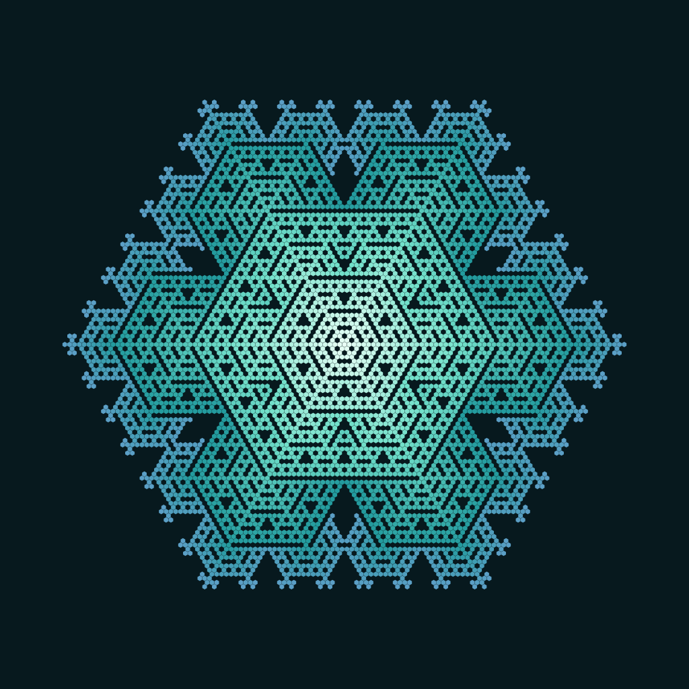

# Automata Studio

A local instrument for discovering, replaying and exporting cellular automata.



## Run it

Install Node.js 20 or newer, open a terminal in this folder, and run:

```sh
npm start
```

Open **http://127.0.0.1:4173** in a modern browser. Stop the server with Ctrl+C.

The classical studio needs **no dependency installation, build step, API key, account or cloud service**. You can also run `node scripts/serve.mjs` directly. The optional Neural experiment needs Python dependencies from `nca/requirements.txt` for training; playback remains native JavaScript. Use the local server rather than opening `index.html` through `file://`, because the app uses native JavaScript modules. Source changes appear after a browser refresh.

Discovery is the centre of the dashboard. Corrected search 004 tested 8,064 rules without spontaneous B0 births against 23 tiny seeds, promoted 1,375 scouts to full-domain evaluation for up to 1,024 generations or an exact repeat, and found 24 rule/seed pairs meeting the sustained-body filter. These are not necessarily distinct behaviours. Cellular Lace (`B2345/S0345`) starts from eight cells and enters a period-2 cycle at generation 13 with 55–57 living cells and 34 changes per step. Independent JavaScript replay verified it through generation 1,024. It is a small oscillator, not an open-ended organism.

The dashboard also includes a secondary local specimen shelf for the K sigil, Pickle study and rat-suit study. Each card can play its saved frames slowly, pause, jump to showcase generations and open the current full-resolution PNG. It reads the ignored `nca-runs/` folders. The server exposes only PNGs from explicitly named runs; checkpoints, targets and personal source images remain inaccessible.

Saved specimen frames are not included in this repository. On a fresh clone, the collection shows an unavailable-state message until you generate them locally:

```sh
.nca-venv/bin/python nca/sigil_ca.py
.nca-venv/bin/python nca/pickle_ca.py
.nca-venv/bin/python nca/pickle_rat_ca.py
```

## Neural growth experiment

The optional neural experiment trains a shared local cellular update rule in PyTorch and plays exported weights in the browser without loading the target image. Targets, photos, progress logs and checkpoints stay in ignored local directories. It follows [Growing Neural Cellular Automata](https://distill.pub/2020/growing-ca/), with no promise of faithful likeness, long-term stability or damage recovery.

For neural training:

```sh
python3.11 -m venv .nca-venv
.nca-venv/bin/pip install -r nca/requirements.txt
npm start
```

Open **Neural experiment**, select a local portrait, inspect the exact 64×64 target, and start training. The page shows progress and can load the learned weights when training finishes.

## Your first avatar

1. Open a preset. It starts paused at an interesting generation.
2. Play, pause, or step through its growth. **Regrow** starts the same seed again and plays. **Reset** returns to generation zero, paused.
3. Pick a palette and adjust frame fill. Check the round previews at 108, 64 and 32 CSS pixels.
4. Export a 512, 1024 or 2048 pixel square PNG. The image contains only the generated pattern and its background, not interface text or a circular mask.
5. Save a snapshot if you want to continue from this exact frame later. **Open snapshot** restores it.

The `examples/` folder includes three PNGs and a matching snapshot for each. They were rendered from this engine, not drawn by an image model.

Keyboard shortcuts: **Space** plays or pauses; **N** advances one generation. Shortcuts do not intercept typing or focused controls. Switching away from the tab pauses the simulation.

## How the rules work

`B1/S0123456` means an empty cell is born with exactly one live neighbour; a living cell survives with any of zero to six live neighbours.

| Preset | Neighbourhood | Rule | Starting pattern |
| --- | --- | --- | --- |
| Cellular Lace | Six neighbours on a hexagonal lattice | `B2345/S0345` | Exact eight-cell search witness |
| Crystal | Six neighbours on a hexagonal lattice | `B1/S0123456` | Single cell |
| Coral | Eight neighbours on a square lattice | `B3/S45678` | Seeded disk |
| Maze | Eight neighbours on a square lattice | `B3/S12345` | Seeded scatter |

Open **Rule laboratory** to change birth and survival counts and apply the new rule. Applying a seed or rule resets the simulation. Choosing a new seed key alone does not apply it; press **Apply seed**. Witness, single-cell and ring seeds have fixed geometry and do not use the random key. Disk and scatter seeds do.

The offline search is reproducible with `npm run search:hex`. It uses NumPy and Pillow from the optional `.nca-venv`, writes bulky search ledgers and previews to ignored `search-runs/`, and promotes no specimen automatically. A candidate enters the browser only after its exact rule, seed coordinates and behavioural invariants are added to authored source.

All cells read the previous generation and update simultaneously. This is a finite 151 × 151 grid with an empty exterior, not a wrapping or infinite world. Playback pauses when a living cell reaches an edge, when a fixed point is detected, or at generation 4096. You can still step after hitting the boundary. Periodic oscillators are not automatically detected.

Colour is a display mapping of each currently living cell's most recent birth generation. It does not affect the transition rule. Framing adapts to the pattern extent, with a minimum viewport around very small seeds; changing framing does not modify cells.

## Keep working with Codex

Open this folder in Codex on your PC. Start with:

> Read AGENTS.md and README.md. Run the app, inspect it in a browser, and help me refine my automata-generated GitHub avatar. Preserve the actual cellular automaton and deterministic snapshots.

## Project map

```text
dist/
  index.html             Application markup
  nca.html               Separate neural training and playback interface
  src/
    app.js               Controls, animation, export, optional agent tools
    specimen-shelf.js    Local specimen generation browser
    engine.js            Pure deterministic cellular automaton
    presets.js           Rule presets and colour palettes
    render.js            Canvas rendering, separate from the simulation
    snapshot.js          Versioned snapshot encoding and validation
    styles.css           Responsive studio interface
    studio.css           Dashboard-specific visual design
    nca-engine.js         Target-free browser inference
    nca-app.js            Neural training and playback controls
nca/                     PyTorch training, target preparation and evaluation
search/                  Bounded exhaustive rule and tiny-seed search
scripts/serve.mjs         Static server plus loopback-only neural training routes
examples/                Engine-generated PNGs and importable snapshots
docs/                    Context, theory, source map and handoff
AGENTS.md                Guidance for continuing development
```

`dist/` is intentionally **authored source**, not disposable build output. Do not delete it or add it to `.gitignore`. The local server exposes only that directory; source documentation and snapshots elsewhere in the repo are not served. The optional `.openai/hosting.json` describes the static root but has no Site ID or deployment credentials. No deployment is required to use the project.

## Checks and limits

Run `npm run check` for all authored JavaScript syntax checks and `npm run check:discovery` for the featured oscillator and exact snapshot continuation invariants. The implementation was additionally checked against a hexagonal single-seed growth reference, a square-grid Life blinker and seeded reproducibility. Example PNGs were generated with the production renderer and decoded to verify their dimensions.

The dashboard and collection have been visually reviewed in a desktop browser, and single stepping was verified. Neural target preparation, model loading and playback have also had local browser checks. A complete mobile, keyboard and download regression pass remains useful. Optional WebMCP tools are feature-detected and are not required for any UI action; their registration was not validated in a supported browser.

The app does not upload your images to a cloud service. Neural training sends the selected image to your local server and stores it locally. Snapshots are local downloads; the app does not autosave. Export before closing the tab or selecting a different preset if you want to retain a frame. The classical studio is not a trained portrait generator, a guaranteed self-repairing organism, or a claimed new scientific discovery. Internal context and experiment handoff notes stay local and are excluded from Git.

## If port 4173 is occupied

macOS / Linux:

```sh
PORT=4174 npm start
```

PowerShell:

```powershell
$env:PORT=4174
npm start
```

Then open the address printed by the server. It binds to loopback by default. Keep the training server local. A static host can serve `dist/` for classical simulation and weight-file playback, but local training routes and the saved specimen shelf require the Node server.
